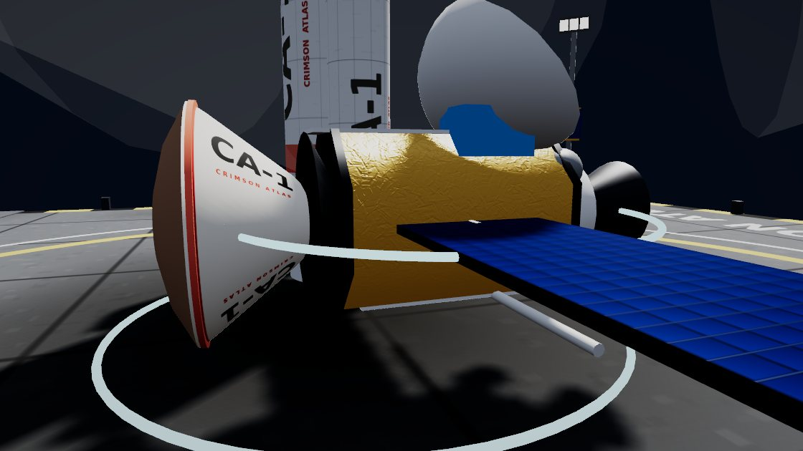
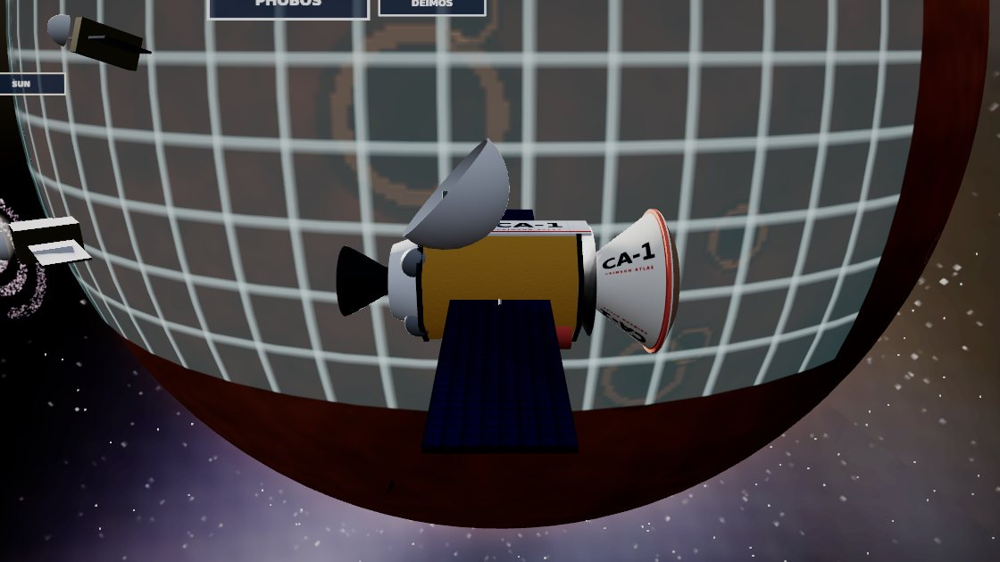
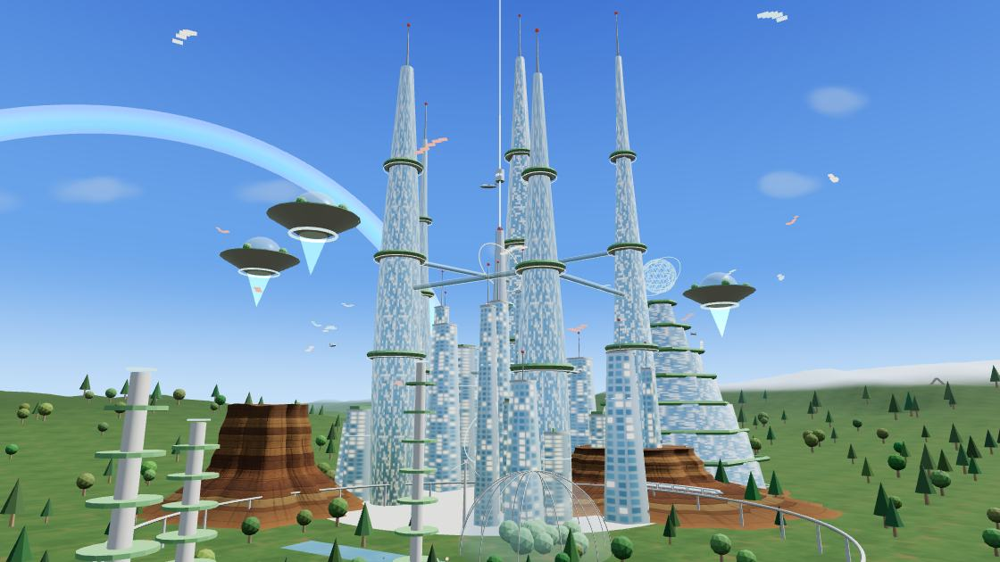
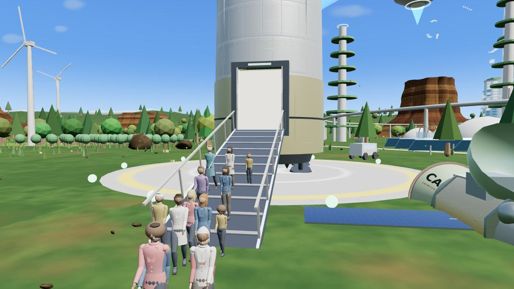

# CRIMSON ATLAS
### Mission to Mars

**Design the mission. Fly the spacecraft. Learn from every decision.**

A single-player, browser-based 3D mission design game for the  
**NASA Space Apps Challenge 2026 · Space Mission Design Game**

[Mission overview](#mission-overview) · [Gameplay](#gameplay) · [Space data](#space-agency-data) · [Technical notes](#technical-notes) · [Credits](#credits--references)

## Mission overview

Getting to Mars is not one decision. It is a chain of decisions that interact: a heavier payload changes launcher requirements, an antenna affects how much science can return, and a poor launch date changes the mission's fuel demands.

**Crimson Atlas** turns those trade-offs into a playable 3D mission. One player acts as the mission team: configuring a spacecraft, choosing a launch window, flying to Mars, scanning and landing, collecting science, and reviewing a debrief that connects outcomes to earlier choices. The aim is not simply to reach Mars—it is to understand **why a design succeeds or fails**.

> **Educational simulation:** The mission model is simplified. Trajectories, landing physics, costs, scores and the future scenarios are not operational flight predictions.

## Gameplay

### 01 · Design and plan

Configure the spacecraft, science instruments, communications, launcher and mission duration. Choose a launch date using an approximate Earth–Mars transfer planner. The design panel shows how changes affect the mission's resources.

| Resource | What the player considers |
| --- | --- |
| **Mass** | Payload and spacecraft mass against launcher capacity |
| **Power** | The energy required to operate the selected equipment |
| **Budget** | The cost of the design and mission choices |
| **Data** | Science collected and the data that can be returned |
| **Communications** | Antenna and downlink capacity |
| **Time** | Transfer and surface mission duration |

### 02 · Launch, travel and scan

Watch the rocket launch and its stages separate, then follow the spacecraft to Mars. Scout satellites scan the planet, and the player selects a landing site while weighing safety against science opportunities.

### 03 · Land and explore

Manage entry and descent using the parachute and retro burn. After landing, deploy the rover, take photographs, investigate the surface and atmosphere, and return data to Earth.

### 04 · Debrief and refly

The mission debrief presents a score, resource results, and explanations of the design decisions behind the outcome. Review the attempt, change the design, and **redesign and refly** to explore a different set of trade-offs.

## Project Genesis · A fictional future

Beyond the mission, Genesis imagines a future spanning more than 75 years. It is presented as **speculative fiction**, not a scientific forecast:

1. **Phase 1 — Robots first:** robotic builders construct a futuristic city on Mars.
2. **Phase 2 — CA-1 arrives:** highly skilled people, animals, and species that help support life travel to Mars.
3. **Phase 3 — The remaining people:** those still on Earth travel in the final phase.

<table>
<tr>
<td width="50%"> The robot-built city</td>
<td width="50%"> CA-1 arrival on Mars</td>
</tr>
</table>

## Space agency data

Real planetary data gives the mission a foundation while the game remains an educational simplification.

| Source | Role in Crimson Atlas |
| --- | --- |
| [NASA Ames / USGS Viking Colorized Global Mosaic (MDIM 2.1)](https://astrogeology.usgs.gov/search/map/mars_viking_colorized_global_mosaic_232m) | Image map for the Mars globe |
| [NASA GISS Mars24 lander locations](https://www.giss.nasa.gov/tools/mars24/help/landers.html) | Coordinates for nine historical Mars landing-site markers |
| [NASA Mars Fact Sheet](https://nssdc.gsfc.nasa.gov/planetary/factsheet/marsfact.html) | Planetary context, including gravity and atmospheric properties |
| [NASA JPL approximate planetary positions](https://ssd.jpl.nasa.gov/planets/approx_pos.html) | Input to the simplified Earth–Mars launch-window model |
| [NASA Mars 2020 Perseverance](https://science.nasa.gov/mission/mars-2020-perseverance/) and [JPL landing quick facts](https://www.jpl.nasa.gov/news/press_kits/mars_2020/landing/quick_facts/) | Reference material and real mission context |

The Mars mosaic is a historical image, **not a live camera feed**. The launch-window planner uses approximate planetary positions and a simplified transfer model, not a flight-certified trajectory calculation. Genesis is fictional; its habitable Mars should not be interpreted as an established or predicted outcome.

## Getting started

### Play locally

1. Download or clone this repository.
2. Open **`index.html`** in a modern browser with WebGL support.
3. Select **Start Mission**, configure the mission, and launch.

The game is packaged as a single HTML file, with Three.js and the relevant game assets bundled inside. No build step or server-side application is required to open the file locally. External reference links require an internet connection; browser and device support can vary.

## Technical notes

- **Application:** HTML, CSS and JavaScript in a single file.
- **3D rendering:** Three.js r128 and WebGL.
- **Mission systems:** resource tracking, configurable design, simplified transfer planning, landing and rover operations, and a decision-based debrief.
- **Accessibility and controls:** browser-based desktop and touch controls; availability and performance vary by browser and device.
- **Narration:** optional browser speech synthesis where supported.
- **Hosting:** static hosting capable of serving the HTML file; no backend is required for the core game.

## Credits & references

**Creator:** Muhammad Mohsin  
**Team:** Crimson Atlas · solo project  
**Challenge:** NASA Space Apps Challenge 2026 — Space Mission Design Game

- **Three.js r128:** [source](https://github.com/mrdoob/three.js/tree/r128) · [MIT license](https://github.com/mrdoob/three.js/blob/r128/LICENSE).
- **Mars imagery:** NASA Ames / NASA JPL / USGS Astrogeology Science Center, [Viking MDIM 2.1 colorized global mosaic](https://astrogeology.usgs.gov/search/map/mars_viking_colorized_global_mosaic_232m).
- **Planetary and mission information:** NASA NSSDCA, NASA GISS, NASA JPL and NASA Science; linked in the [space data table](#space-agency-data).
- **Third-party notices:** See [THIRD-PARTY-NOTICES.txt](THIRD-PARTY-NOTICES.txt) for license and attribution details.
- **AI assistance:** AI was used for development and troubleshooting; the project concept and creative direction were provided by the project owner.
